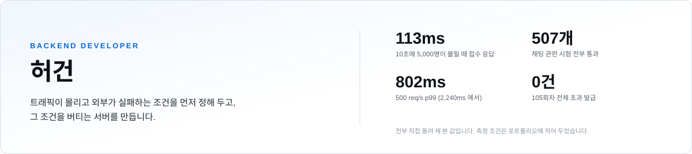

<picture><source media="(prefers-color-scheme: dark)" srcset="https://raw.githubusercontent.com/HUHGEON/HUHGEON/main/cards/hero-dark.svg?v=2"></picture>

[포트폴리오](https://huhgeon.github.io/portfolio/) &nbsp;·&nbsp; [기술 블로그](https://huhgeon.github.io) &nbsp;·&nbsp; [rjs2337@naver.com](mailto:rjs2337@naver.com)

## Projects

<table>
<tr>
<td width="50%" valign="top">

#### [NOVA](https://github.com/Nova-Grandis/be)

대규모 트래픽 커머스 · 7인 팀 · `2026.09 ~ 10`

- 10초에 5,000명이 몰릴 때 접수 응답 **113ms**, 서버 오류 **0건**
- 동시 접수 데드락 **4/4 → 0/4**

`Java` `Spring Boot` `MySQL` `AWS SQS`

</td>
<td width="50%" valign="top">

#### [sapari 라이브 채팅](https://github.com/sago-panda/sapari-be)

라이브 커머스 채팅 서버 · 단독 담당 · `2026.06 ~`

- 채팅 관련 시험 **507개** 전부 통과
- 채팅 모듈 커밋 **159개** 전부 본인

`Spring WebFlux` `WebSocket` `Redis` `MongoDB`

</td>
</tr>
<tr>
<td width="50%" valign="top">

#### [쿠폰야호](https://github.com/coupon-yaho/cy-be)

선착순 발급과 적응형 대기열 · 조장 · `2026.08`

- 500 req/s 성공 응답 p99 **2,240ms → 802ms**
- 초과 발급 **0건**, 오염 데이터 검출 **800 / 800**

`Spring Batch` `MySQL` `Redis` `Kafka`

</td>
<td width="50%" valign="top">

#### [음성인식 키오스크](https://github.com/Say-It-It-s-OK/nlp)

NLP 서버 설계 주도 · 캡스톤디자인 금상 · `2025.03 ~ 06`

- LLM 출력을 intents **9종** 스키마로 가둬 순차 실행으로 변환
- 시스템 프롬프트 **1,087줄**, NLP 서버 커밋 **42/47**

`FastAPI` `gpt-4o-mini` `Express` `MongoDB`

</td>
</tr>
</table>

전체 프로젝트와 측정 조건은 [포트폴리오](https://huhgeon.github.io/portfolio/)에 있습니다.

<table>
<tr>
<td width="55%" valign="top">

#### About

`2020.03 ~ 2026.02` &nbsp;학력&nbsp; 명지대학교 컴퓨터공학과 
`2026.04 ~ 2026.10` &nbsp;교육&nbsp; LG U+ 유레카 백엔드 과정 수료 
`2025.08 ~ 2026.01` &nbsp;경력&nbsp; 백엔드 개발 인턴 
`2025.06` &nbsp;자격&nbsp; SQLD · 한국데이터산업진흥원 
`2025.06` &nbsp;금상&nbsp; 명지대학교 캡스톤디자인 
`2024.09` &nbsp;대상&nbsp; 코드잇 데모데이

</td>
<td width="45%" valign="top">

#### Stack

**Language** &nbsp; `Java` `Python`

**Framework** &nbsp; `Spring Boot` `WebFlux` `JPA` `FastAPI`

**Data** &nbsp; `MySQL` `Redis` `MongoDB` `Kafka`

**Infra** &nbsp; `Docker` `Kubernetes` `AWS` `Grafana`

</td>
</tr>
</table>

 

