<picture>
  <source media="(prefers-color-scheme: dark)" srcset="https://raw.githubusercontent.com/HUHGEON/HUHGEON/main/cards/banner-dark.svg">
  
</picture>

 
 

 

<table>
<tr><td width="120"><b>Language</b></td><td>

</td></tr>
<tr><td><b>Framework</b></td><td>

</td></tr>
<tr><td><b>Data</b></td><td>

</td></tr>
<tr><td><b>Infra</b></td><td>

</td></tr>
<tr><td><b>Awards</b></td><td>
🥇 명지대학교 캡스톤디자인 <b>금상</b> &nbsp;·&nbsp; 🏆 코드잇 데모데이 <b>대상</b>
</td></tr>
</table>

 

 
